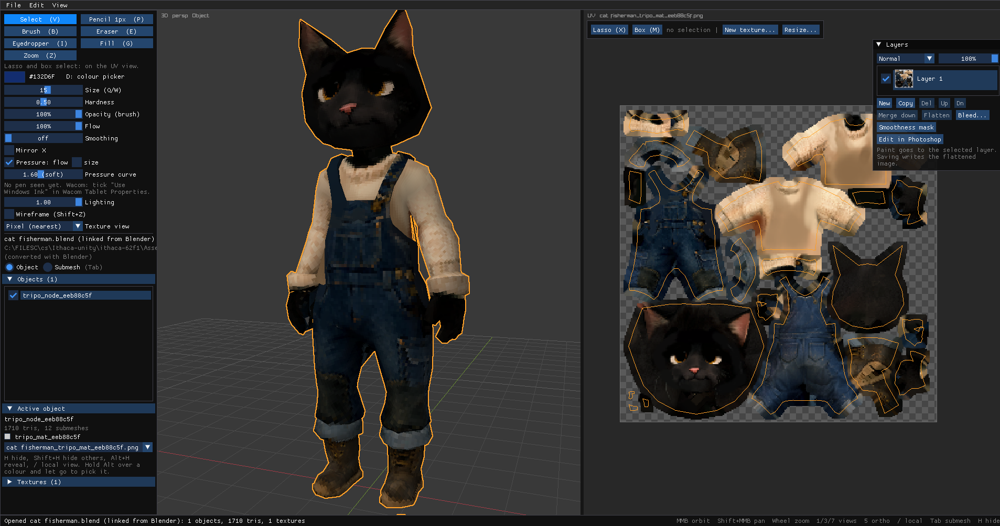

# Sable

Paint textures on 3D models, on the model itself or on its UV layout, with the layers, brushes and shortcuts of an image editor.



Blender's texture painting is limited next to Photoshop or Krita, and painting in an image editor means working blind on a flat UV sheet. Sable puts the two side by side: a 3D view and a UV view of the same texture, where a stroke in either shows up in both. It stays linked to Blender while you work, so you can change the model in Blender without losing what you've painted.

It's built for both pixel art (an exact one-texel pencil, nearest filtering, a texel grid) and general asset painting (soft pressure brushes, layers and blend modes).

## Features

**Painting**
- Pencil, soft brush, eraser, fill (by similar colour, UV island or face) and an eyedropper, also on Alt from any tool
- Brushes with hardness, opacity and flow that behave like Photoshop's, Wacom pen pressure with an adjustable curve, and stroke smoothing
- Strokes on the model carry across UV seams, and Mirror X paints both sides of a symmetric model, in either view
- Texel selections with lasso and box, moving and free transform (Ctrl+T), and pasting images from the clipboard as a new layer

**Layers**
- Layers with Normal, Multiply, Screen, Overlay and Add blend modes, opacity, merge down and flatten, using Photoshop's keys
- A smoothness mask layer for marking shiny areas, previewed in the lit 3D view
- Saving writes a normal flattened PNG, so engines only ever see an ordinary texture, and keeps the layers in a hidden file beside it

**Pipeline**
- **Blender link:** a Blender add-on sends the selected objects to Sable and keeps them up to date as you edit geometry, UVs or modifiers. Saving reloads the textures in Blender.
- **Photoshop link:** sends the texture's layers to Photoshop as a PSD, with the UV layout as a guide layer, and reads them back each time Photoshop saves.
- **Unity export:** writes a URP Lit material with its colour and smoothness textures, already set up for pixel art. Re-exporting keeps Unity's references to it intact.
- Opens FBX, glTF/GLB, OBJ, DAE, 3DS, PLY, and `.blend` (through Blender)
- Edge padding when saving, so seams don't show once mipmapped, plus Stack UV islands in Blender, so repeated parts share one patch of texture

**Practical details**
- Autosave and crash recovery
- Blender-style navigation (orbit, numpad views, local view, frame selection)
- Settings remembered between sessions
- A frame profiler that logs any stutter with a breakdown of where the time went

## Getting started

Sable runs on 64-bit Windows. Opening `.blend` files and the Blender link need Blender 4.2 or later.

**Run from source** (needs the [.NET 9 SDK](https://dotnet.microsoft.com/download/dotnet/9.0)):

```bash
cd src/Sable
dotnet run -- path/to/model.fbx
```

**Build the installer** (needs [Inno Setup 6](https://jrsoftware.org/isinfo.php)):

```bash
python installer/build.py
```

This makes `installer/output/SableSetup-<version>.exe`, a self-contained install that doesn't need .NET or admin rights.

**Install the Blender add-on:**

```bash
python blender/build.py
```

In Blender, install `blender/dist/sable_link-<version>.zip` under Edit > Preferences > Get Extensions > Install from Disk, then use Object > Send to Sable.

## Documentation

The [manual](docs/manual.md) covers everything in detail, including [navigation](docs/manual.md#navigation), [tools](docs/manual.md#tools), [layers](docs/manual.md#layers), the [Blender link](docs/manual.md#blender-link), the [Photoshop link](docs/manual.md#photoshop-link), [textures and files](docs/manual.md#textures-and-files), [troubleshooting](docs/manual.md#troubleshooting), the [command line](docs/manual.md#command-line) and the [code layout](docs/manual.md#code-layout).

## Built with

C# on .NET 9, with [Raylib-cs](https://github.com/ChrisDill/Raylib-cs), [ImGui.NET](https://github.com/ImGuiNET/ImGui.NET) via [rlImGui-cs](https://github.com/raylib-extras/rlImGui-cs), and [AssimpNet](https://bitbucket.org/Starnick/assimpnet). The Blender add-on is Python.
